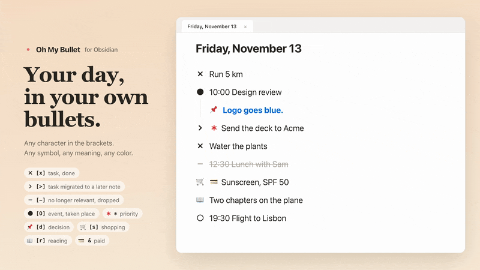

# Oh My Bullet

Turn task checkboxes into paper-style bullets, and combine them freely with signifiers. Use the ones it comes with, or make your own: any character, any symbol, a meaning, a color, a style.



Your notes stay plain Markdown. A bullet is the character between the brackets of a task, as in `- [x]`, so everything you write still works in any other app, and in other plugins such as Tasks.

## Bullets

| You type | Shown as | Meaning |
| --- | --- | --- |
| `- [ ]` | • | Task, not done |
| `- [/]` | / | Task in progress |
| `- [x]` | × | Task, done |
| `- [>]` | > | Task migrated to a later note |
| `- [<]` | < | Task scheduled for a future date |
| `- [-]` | – (struck through) | No longer relevant, dropped |
| `- [o]` | ○ | Event |
| `- [O]` | ● | Event that has taken place |

## Signifiers

A signifier is one character typed right after the checkbox. It adds meaning to any bullet.

| You type | Shown as | Meaning |
| --- | --- | --- |
| `- [ ] * Send the deck` | • ✱ Send the deck | Priority |
| `- [ ] ! Plants that text you?` | • ! Plants that text you? | Inspiration, an idea worth keeping |

## Make your own

In **Settings → Oh My Bullet**, add as many bullets and signifiers as you like.

- **Bullets**: pick the character for the brackets, the symbol to draw (an emoji works too), a meaning, the bullet's color, and how the line's text looks: its color, struck through, underlined, bold or italic.
- **Signifiers**: pick the character, the symbol, a meaning, a color, and where it is drawn: left of the bullet, on top of it, or right of it, before the text.

Each one shows a live preview while you edit it. For example:

| You type | Shown as | A bullet for |
| --- | --- | --- |
| `- [d] Logo goes blue.` | 📌 **Logo goes blue.** (in blue) | Decisions |
| `- [s] Sunscreen` | 🛒 Sunscreen | Shopping |
| `- [r] Two chapters on the plane` | 📖 Two chapters on the plane | Reading |

## Changing a bullet

- **Right-click** a bullet, or **touch and hold** it on a phone, to choose another bullet or toggle a signifier from a menu. Your own bullets and signifiers are in the menu too.
- Or type it: put the cursor between the brackets and change the character.
- **Clicking or tapping** a bullet does nothing by default, so a stray tap never changes a task. You can make it mark the task done or open the menu instead.
- The command **Oh My Bullet: Choose a bullet for this line** opens the same menu for the line you are on. Give it a hotkey, or add it to the mobile toolbar. Every bullet and signifier also has a command of its own.

## A legend for AI agents

AI agents read the raw text of your notes, so they see `- [>]`, not >. Turn on **Keep a legend for AI agents** and the plugin keeps a short section in `AGENTS.md` and `CLAUDE.md` at the top of your vault that says what each bullet and signifier means. If neither file exists, `AGENTS.md` is created. The rest of those files is never touched.

You can also add the legend to each note that uses your notation, as a `bullet-legend` property, so the meaning travels with the note.

## Works with

- Live Preview and reading view
- Light and dark mode, and any theme
- Desktop and mobile
- The [Tasks](https://github.com/obsidian-tasks-group/obsidian-tasks) plugin: its query results show your bullets and signifiers too

## Installation

In Obsidian, open **Settings → Community plugins → Browse**, search for **Oh My Bullet**, then select **Install** and **Enable**. You can also open [its page in the plugin directory](https://community.obsidian.md/plugins/oh-my-bullet) and select **Add to Obsidian**.

To install it by hand instead:

1. Download `main.js`, `manifest.json` and `styles.css` from the [latest release](../../releases/latest).
2. Put them in `<your vault>/.obsidian/plugins/oh-my-bullet/`.
3. Reload Obsidian, then turn on **Oh My Bullet** in **Settings → Community plugins**.

## Development

```bash
npm install
npm run dev     # rebuild main.js on every change
npm run build   # type-check and build for production
npm run lint
```

## License

[MIT](LICENSE)
